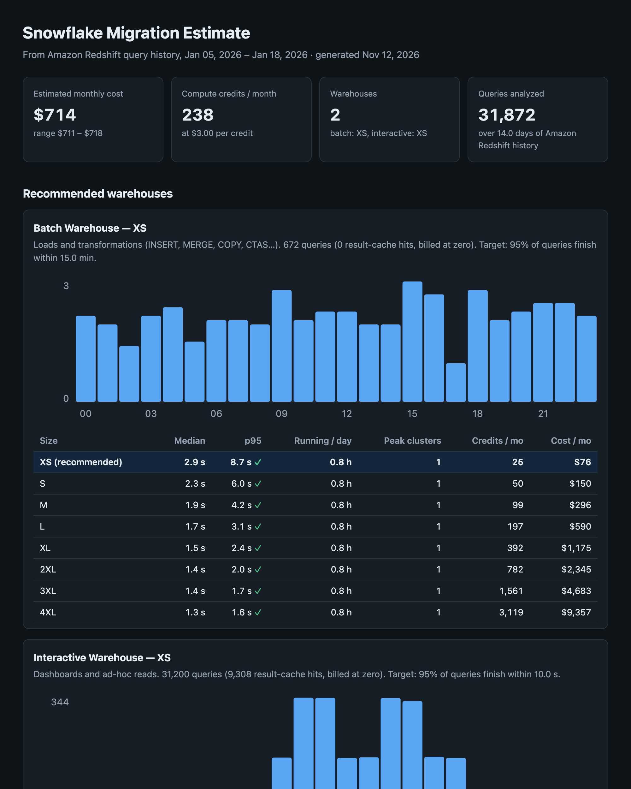
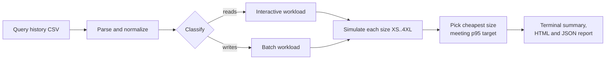

# Snowflake Migration Estimator

Estimate Snowflake warehouse sizes and monthly cost from your real Redshift, BigQuery, or Postgres query history.



## Why

The first question in almost every Snowflake conversation is "what will this cost us?" Generic
pricing calculators answer it with guesses about warehouse size and hours per day. This tool
answers it from what the prospect already runs: it replays their actual query history against
Snowflake's billing model (per-second billing, auto-suspend, multi-cluster scale-out) and
recommends a warehouse size per workload, with a cost range and every assumption written out.

The output is a starting point for a proof of concept, not a quote. It is built so that every
number can be challenged, overridden, or measured.

## Quick start (60 seconds, sample data)

Requires Python 3.9+.

```bash
git clone <this-repo-url> snowflake-migration-estimator
cd snowflake-migration-estimator
python -m venv .venv
source .venv/bin/activate          # Windows: .venv\Scripts\activate
pip install -e ".[snowflake]"

sfestimate samples                 # writes 9 CSVs to ./samples
sfestimate estimate --source redshift samples/bi_team_redshift.csv --html report.html
open report.html                   # macOS; use xdg-open on Linux, start on Windows
```

The estimator itself uses only the Python standard library. The `[snowflake]` extra adds the
Snowflake connector, `cryptography`, and `python-dotenv`, which are needed only for `keygen`,
`check`, and `calibrate`. `pip install -e .` is enough if you just want estimates.

The sample generator simulates two weeks of three kinds of company and writes the same workload
in each source's export format:

| Profile      | Description                                                                 |
|--------------|-----------------------------------------------------------------------------|
| `startup`    | Small analytics team: a few hundred queries a day, light nightly ETL        |
| `bi_team`    | Busy BI org: thousands of dashboard queries in business hours, hourly loads |
| `batch_shop` | Heavy nightly batch: large transformations, few interactive users           |

Files are named `{startup,bi_team,batch_shop}_{redshift,bigquery,postgres}.csv`. Try the others:

```bash
sfestimate estimate --source bigquery samples/batch_shop_bigquery.csv --json out.json
sfestimate estimate --source postgres samples/startup_postgres.csv --window-days 14
```

## Commands

| Command | What it does |
|---|---|
| `sfestimate samples [--out samples]` | Write the 9 sample CSVs. |
| `sfestimate estimate --source {redshift,bigquery,postgres} FILE [options]` | Estimate sizes and cost; print a summary, optionally write HTML/JSON. |
| `sfestimate keygen` | Create a key pair for Snowflake key-pair authentication. |
| `sfestimate check` | Test the Snowflake connection configured in `.env`. |
| `sfestimate calibrate [--warehouse SFESTIMATE_CALIBRATION_WH] [--scale 10]` | Measure runtime constants on your Snowflake account; write `calibration.json`. |

`estimate` options:

| Option | Default | Meaning |
|---|---|---|
| `--html report.html` | none | Write a self-contained HTML report. |
| `--json out.json` | none | Write the full estimate as JSON. |
| `--price-per-credit` | `3.0` | USD per credit (Enterprise list price, AWS US). |
| `--storage-tb` | `0` | Compressed data volume in Snowflake, in TB. |
| `--storage-price` | `23` | Storage price in USD per TB-month. |
| `--auto-suspend` | `60` | Warehouse auto-suspend, in seconds. |
| `--interactive-p95` | `10` | Target p95 runtime for reads, in seconds. |
| `--batch-p95` | `900` | Target p95 runtime for writes/transformations, in seconds. |
| `--compression X` | per source | Source bytes per Snowflake byte scanned (Redshift 1.0, BigQuery 4.0, Postgres 3.0). |
| `--calibration calibration.json` | none | Use runtime constants measured by `sfestimate calibrate`. |
| `--window-days N` | from data | Length of the observation window. **Required for Postgres** (use `14` for the samples). |

## Using your own data

Run the export query for your source and save the result as CSV:

| Source   | Export query                    | Reads from |
|----------|---------------------------------|------------|
| Redshift | `export_queries/redshift.sql`   | `SYS_QUERY_HISTORY` joined to `SYS_QUERY_DETAIL` |
| BigQuery | `export_queries/bigquery.sql`   | `INFORMATION_SCHEMA.JOBS` |
| Postgres | `export_queries/postgres.sql`   | `pg_stat_statements` |

Then:

```bash
sfestimate estimate --source redshift my_history.csv --html report.html --storage-tb 12
```

Notes:

- Column names are matched case-insensitively. If a required column is missing, the error names
  it and points back to the export query.
- Failed queries, utility/DDL statements, and BigQuery script parents are skipped.
- Two to four weeks of history is a good window: long enough to include month-end jobs and
  weekly patterns, short enough to export quickly.
- **Postgres** is a special case. `pg_stat_statements` keeps per-statement totals, not individual
  executions with timestamps, so the parser spreads each statement's calls across the window
  (reads in weekday business hours, writes overnight) and samples high-volume statements with
  weights. That is why `--window-days` is required: pass the number of days since the stats were
  last reset. Treat Postgres estimates as rougher than Redshift or BigQuery ones.
- The export contains query metadata (timings, bytes, statement types, user identifiers), and for
  Postgres the normalized SQL text. Review it before sharing it outside your organization.

## How the estimate works

Each query is routed to a workload: writes (`INSERT`, `UPDATE`, `MERGE`, `COPY`, CTAS, ...) go to
a **batch** warehouse, everything else to an **interactive** warehouse. Splitting reads from
writes is the standard Snowflake pattern, so dashboards stay fast while loads run on their own
warehouse. Then, for each workload and each warehouse size from X-Small to 4X-Large, the tool
replays the query timeline and bills it the way Snowflake would.



The simulation has four steps:

1. **Runtime.** A query's runtime on an X-Small warehouse is a fixed overhead plus
   bytes scanned divided by scan throughput. Source bytes are first converted to Snowflake's
   compressed columnar bytes (BigQuery reports logical uncompressed bytes, Postgres reads
   uncompressed row pages, Redshift is already compressed and columnar). On a larger warehouse
   with N times the nodes, the scan part shrinks by N<sup>scaling_efficiency</sup>. If the source
   did not record bytes, its own runtime is used instead.
2. **Billing.** A running warehouse is billed per second, with a 60-second minimum each time it
   resumes, and stays running until it has been idle for the auto-suspend period. The replay
   merges queries into running periods and bills them that way. Source result-cache hits cost
   nothing.
3. **Concurrency.** One cluster runs about 8 queries at once (`MAX_CONCURRENCY_LEVEL`). When more
   overlap, a multi-cluster warehouse adds clusters (up to 10), and the extra clusters are billed
   only for the seconds they are needed.
4. **Sizing.** For each workload, the recommendation is the cheapest size whose 95th-percentile
   query time meets the target (10 s interactive, 15 min batch by default). If no size meets it,
   the report says so and recommends the fastest one.

The cost range re-runs the whole estimate with scan throughput halved and doubled, because that
constant dominates the result. The whole model is in
[`src/sfestimate/estimator.py`](src/sfestimate/estimator.py), which is short enough to read in one sitting.

## Calibrating on your Snowflake account

The default runtime constants (150 MB/s per X-Small, 0.4 s overhead, 0.85 scaling efficiency) are
reasonable starting points, not measurements. `sfestimate calibrate` measures them on your own
account. A free Snowflake trial works.

Snowflake requires MFA for password sign-in, so scripts authenticate with a key pair.

1. **Create a key pair.**

   ```bash
   sfestimate keygen
   ```

   This writes `keys/rsa_key.p8` (private key) and the matching public key, and prints an
   `ALTER USER ... SET RSA_PUBLIC_KEY='...'` statement.

2. **Register the public key.** In Snowsight, open a SQL worksheet and run the printed
   `ALTER USER` statement as your user (or as an admin for a service user).

3. **Configure `.env`.**

   ```bash
   cp .env.example .env
   ```

   Set `SNOWFLAKE_ACCOUNT` (account identifier, `orgname-accountname`, shown in Snowsight's
   account details), `SNOWFLAKE_USER`, and if needed
   `SNOWFLAKE_PRIVATE_KEY_PATH`, `SNOWFLAKE_ROLE`, and `SNOWFLAKE_WAREHOUSE`.

4. **Check the connection.**

   ```bash
   sfestimate check
   ```

5. **Calibrate.**

   ```bash
   sfestimate calibrate                       # defaults: --warehouse SFESTIMATE_CALIBRATION_WH --scale 10
   ```

   This creates an X-Small (and a Small) warehouse, runs TPC-H benchmark queries against
   `SNOWFLAKE_SAMPLE_DATA` with the result cache turned off, reads the actual runtimes and bytes
   scanned from `QUERY_HISTORY`, fits `throughput_mb_s_xs`, `overhead_s`, and
   `scaling_efficiency`, writes them to `calibration.json`, and suspends the warehouse. It costs
   well under one credit. The role needs privileges to create warehouses (`ACCOUNTADMIN` on a
   trial, or `SYSADMIN`).

6. **Use it.**

   ```bash
   sfestimate estimate --source redshift my_history.csv --calibration calibration.json --html report.html
   ```

`calibration.json` contains no secrets and can be committed, so others can reproduce your
estimate. The private key and `.env` are git-ignored; keep it that way.

## Accuracy and validation

Be clear-eyed about what this is.

- **Defaults are starting points.** Without calibration, runtimes come from published-ballpark
  constants. The report says so on the page.
- **Calibration measures your account, not your workload.** TPC-H scans are a reasonable proxy
  for analytic queries, but joins, spilling, semi-structured data, and very selective queries
  (where pruning matters) behave differently.
- **Bytes conversion is the largest single uncertainty** for BigQuery and Postgres sources. If you
  know your data's compression ratio, pass `--compression`.
- **The cost range is a sensitivity bracket**, not a confidence interval: it shows how much the
  answer moves if scan speed is half or double the assumption.
- **Not yet validated against billed credits.** The roadmap includes running a public benchmark
  workload through the estimator and through Snowflake, and publishing predicted versus actual
  credits. Until then, use the output to choose starting warehouse sizes and frame a budget for
  a proof of concept, then measure.

## Assumptions and limits

Included: virtual warehouse compute for the observed workload, and storage if you pass
`--storage-tb`.

Not included:

- Serverless features: Snowpipe, automatic clustering, search optimization, materialized view
  maintenance, serverless tasks, replication.
- Cloud services credits above the free 10% daily allowance.
- Data transfer and egress.
- Migration labor: code conversion, testing, cutover.

Other assumptions:

- Standard (not Snowpark-optimized) warehouses. Multi-cluster warehouses require Enterprise
  edition or higher.
- Queries are replayed at their original start times. Snowflake's own result cache and local
  disk cache usually lower cost further, so the estimate leans conservative there.
- Pricing defaults: **$3.00 per credit** (Enterprise edition, AWS US list price) and
  **$23 per TB-month** of storage (capacity pricing, AWS US). Prices vary by edition, cloud,
  region, and contract. **Verify current pricing** on Snowflake's pricing page and pass
  `--price-per-credit` accordingly.

## How this differs

There are good adjacent tools. querycost (on GitHub) estimates the cost of individual
queries, which is useful for tuning a single statement. finitizer translates BigQuery spend into
a Snowflake cost estimate; it covers BigQuery only and is not open source. Generic pricing
calculators take a size and hours-per-day as input.

This project fills a different gap: it is open source, reads history from several source
systems, and derives warehouse sizes and hours from the actual timeline of queries rather than
asking for them. If you know of a similar tool, please open an issue so it can be listed here.

## Roadmap

- **Predicted vs. actual validation.** Run a public benchmark workload through the estimator and
  through Snowflake, compare predicted and billed credits, and publish the error.
- **Redset support.** Parse [Redset](https://github.com/amazon-science/redset), Amazon's public
  dataset of Redshift query metadata (VLDB 2024, CC BY-NC 4.0), to test the estimator on real
  fleet workloads. The dataset's non-commercial license applies to any use of it.
- **Snowflake-native Streamlit app.** Upload an export and get the report inside Snowsight.

## Contributing

Issues and pull requests are welcome. Good first contributions: an export query for another
source, a better classifier for workloads, or real-world calibration results (with anything
sensitive removed).

```bash
pip install -e ".[snowflake,dev]"
pytest
```

Please keep the estimator dependency-free (standard library only), add tests for behavior
changes, and document any new assumption in the report as well as here.

## License

[MIT](LICENSE)

## Disclaimer

This is a community project. It is not affiliated with, sponsored by, or endorsed by Snowflake
Inc. "Snowflake" is a trademark of Snowflake Inc. Estimates are for planning only and are not a
quote; actual cost depends on your workload, configuration, and contract.
